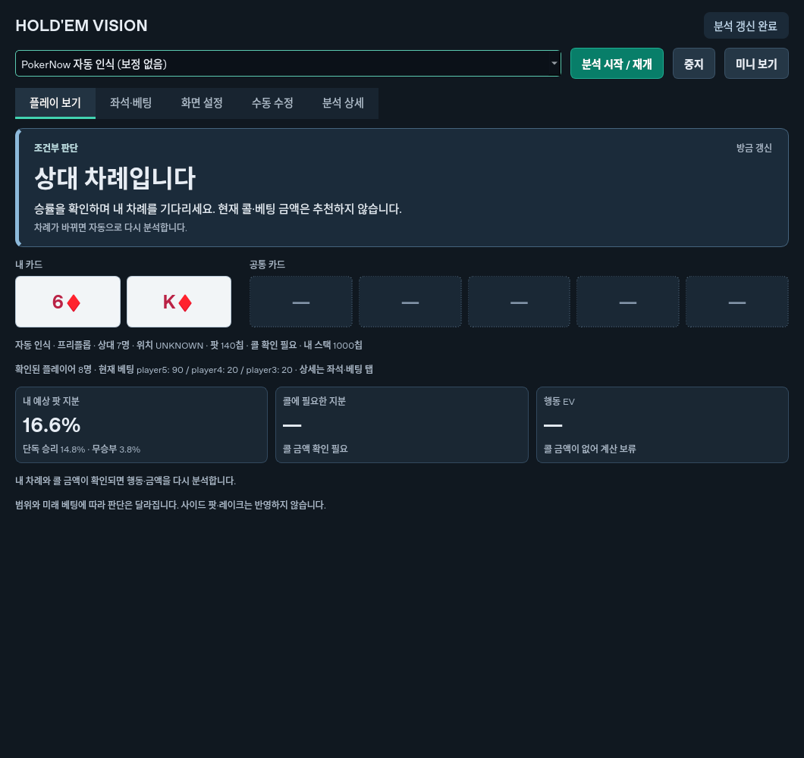
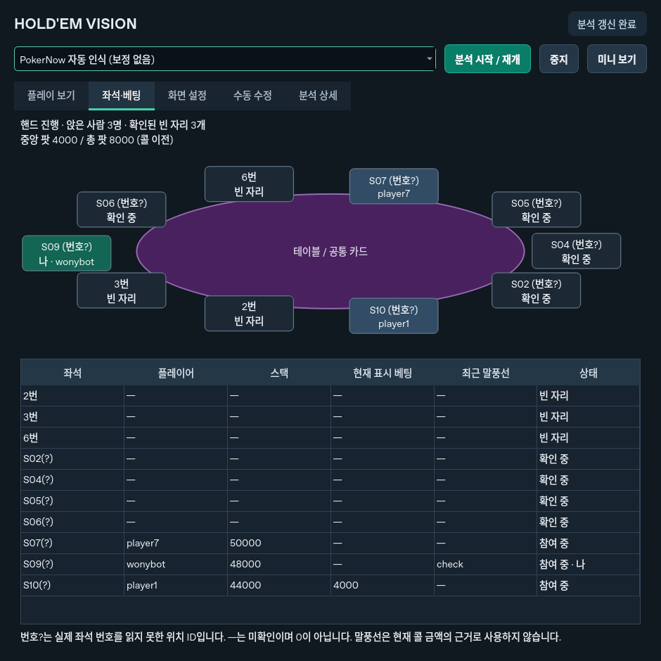
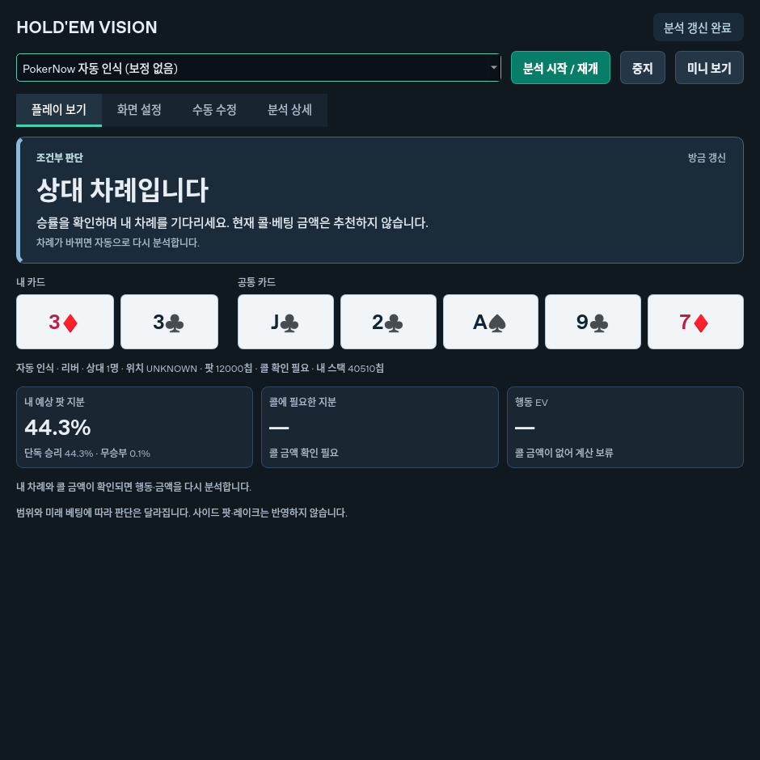

# Texas Hold'em Vision Analyzer

Python 3.12 / PySide6 Windows 데스크톱 앱입니다. **0.6.0은 Ollama 로컬 시각 모델 모드**를 추가합니다. 사진 전체와 카드 확대 영역을 PC의 이미지 이해 모델에 전달해 카드·좌석·팟·베팅을 읽고 검증합니다. 외부 API 키·이미지 외부 전송·Tesseract가 필요 없습니다. 기존 OCR 모드도 선택할 수 있습니다.

**로컬 AI 사용:** [Ollama 설치](https://ollama.com/download/windows) → `setup_local_ai.bat`로 모델 받기 → `run_windows.bat` → **화면 설정 → 로컬 AI로 실제 사진 읽기**. [처음부터 따라 하는 한국어 로컬 AI 안내](docs/LOCAL_AI_KO.md)를 참고하세요. 모델 설치는 한 번 인터넷을 사용하며, 인식 요청은 `127.0.0.1` 안에서 처리합니다.

이 채팅과 동일한 모델·정확도를 보장하지 않습니다. 현재 클라우드에는 Ollama 모델과 사용자 원본 파일이 없어 **실제 로컬 모델의 사진 인식 정확도를 검증하지 못했습니다.** 로컬 모드 테스트는 통신·데이터 검증·취소·UI 검사이며, 실제 사진을 읽어 성공했다는 뜻이 아닙니다. 로컬 실시간 주기는 기본 최소 5초이며 PC 처리 속도에 따라 더 오래 걸립니다. 결과의 캡처 시점을 표시하고 화면 변경 시 현재 행동 판단을 보류합니다.

**[Windows 실행용 코드 ZIP 다운로드](https://github.com/Wonybott/holdem/archive/refs/heads/main.zip)** — 압축을 푼 뒤 아래 설치 안내를 따르세요. 비공개 저장소는 GitHub 로그인이 필요합니다.

**처음 사용하는 분:** [다운로드부터 실행·실제 화면 설정까지 한국어 안내](docs/START_HERE_KO.md).

Windows에서 [Python 3.12 64비트](https://www.python.org/ftp/python/3.12.10/python-3.12.10-amd64.exe)를 설치하고 ZIP을 풀어 **run_windows.bat**를 더블클릭하세요. **Python 3.14만 설치된 경우 3.12를 추가 설치하세요.** 3.14를 삭제할 필요는 없습니다. 현재 고정된 GUI 패키지는 3.14와 호환되지 않습니다. 직접 실행하려면 프로젝트 폴더의 PowerShell에서 다음을 사용합니다.

```powershell
py -3.12 -m venv .venv
.\.venv\Scripts\python.exe -m pip install -r requirements.txt
.\.venv\Scripts\python.exe -m src.main
```

기존 OCR 모드의 실제 화면 자동 인식에는 외부 프로그램 Tesseract(영어 데이터)가 필요합니다. 로컬 AI 모드에는 필요 없습니다. 모의 모드는 추가 OCR 설치 없이 실행됩니다. 앱은 로컬 화면 픽셀만 사용합니다. 사이트 API·DOM·패킷 접근, 자동 클릭·베팅을 구현하지 않습니다. 사이트의 사용 허가 여부를 확인한 제품이나 공식 연동이 아닙니다.

## 기존 OCR로 보정 없이 실행하기

1. Tesseract 설치 후 `run_windows.bat`를 실행합니다. 기존 OCR을 쓰려면 **PokerNow 자동 인식 (보정 없음)**을 선택합니다. Windows 기본 선택은 **로컬 AI 인식 (Ollama)**입니다.
2. 브라우저 테이블을 크게 띄우고 **분석 시작 / 재개**를 누릅니다. 필요하면 화면 설정에서 모니터 번호만 바꾸세요.
3. 큰 설정창은 최소화되고 **작은 실시간 분석창**이 열립니다. 테이블을 가리지 않는 곳으로 드래그해 옮길 수 있습니다. **전체 보기**로 돌아갑니다.
4. 파일 사진을 확인하려면 **화면 설정 → PokerNow 사진 자동 읽기**를 사용합니다. 영역 선택이나 카드 샘플 등록을 요구하지 않습니다. 이후 위쪽 분석 시작을 누르면 실제 화면 캡처로 전환합니다.

새 카드의 첫 OCR과 두 프레임 안정화에는 수 초가 걸릴 수 있습니다. 내 차례나 활성 CALL/CHECK 버튼이 확인되지 않으면 행동을 보류하며 콜을 0으로 채우지 않습니다. 상대 차례에도 카드·팟 지분은 표시합니다. 위치를 확인하지 못하면 UNKNOWN으로 둡니다. 사진처럼 활성 플레이어 패널의 밝기가 바뀌는 테마를 우선 지원합니다.

## 0.5.1 패 표시·다인 테이블 수정

- 여러 명이 앉은 프리플롭에서 기울어진 내 패와 이름·스택 패널을 연결하는 방식을 수정했습니다. 카드 숫자 중심이 옆자리와 더 가까운 경우에도 카드 외곽과 패널 간 거리를 비교합니다.
- 팟·좌석 판독이 실패해도 **독립적으로 확정한 내 카드와 보드**는 큰 화면과 미니 창에 표시합니다. 전체 분석이 끝나기 전에는 승률·행동·금액을 보여주지 않습니다. 다음 화면에서 카드가 가려지거나 중지하면 이전 카드를 지웁니다.
- 중앙 팟 `0`의 밝은 글자를 흰 패널로 잘못 제외하던 문제와, 좌석 사이 빈 공간을 카드 뒷면으로 오인하는 경우를 수정했습니다. 밝은 배지는 스택으로 취급하지 않습니다.
- 6♦ K♦, 참가자 8명, 중앙 팟 0 / total 140 배치를 **자체 생성 이미지**로 재현해 검사합니다. 실제 첨부 원본이나 Windows의 검증 완료를 뜻하지 않습니다.



## 전체 화면·좌석·베팅 (0.5)

- 화면을 테이블에 딱 맞게 자르지 않아도 됩니다. 먼저 펠트를 찾고, 원본 화면에서 주변 좌석과 행동 버튼까지 포함한 부분을 자동 확대해 읽습니다.
- **좌석·베팅** 탭은 탐지한 좌석 위치, 실제 읽힌 좌석 번호, 빈 자리/플레이어/참여 여부, 스택과 현재 표시 베팅을 보여줍니다. 흐린 번호를 못 읽으면 위치 ID와 `번호?`로 표시하며 번호를 만들어 내지 않습니다.
- 내 패는 위치 고정 대신, 공통 카드 행 바깥의 공개된 두 카드와 가까운 플레이어를 연결합니다. 공개 패가 여러 쌍이면 **화면 설정 → 내 닉네임**으로 구분할 수 있습니다. 이름 문자열은 OCR 결과이므로 한글 이름의 일반 정확도는 보장하지 않습니다.
- 빈 자리, 다음 핸드 대기, 관측한 폴드는 현재 상대 수로 취급하지 않습니다. 오프라인 표시만으로 폴드했다고 가정하지 않습니다. 최대 10인(상대 9명)을 모델과 계산 엔진에서 지원하지만, 인원/카드/스택을 확정하지 못한 실제 화면은 판단을 보류합니다.
- 중앙 팟 `4000`, 상대 표시 베팅 `4000`, `total 8000`은 별도 필드입니다. 콜 비용이 `4000`이면 팟 오즈는 `4000/(8000+4000)=33.3%`입니다. 베팅 표시가 있는데 총 팟을 못 읽으면 추측해서 EV를 계산하지 않습니다.
- 이전 `check` 말풍선은 현재의 무료 체크 근거가 아닙니다. 밝게 활성화된 `CALL 4000`을 우선하며, 어두운 CHECK나 사전 선택 CHECK OR FOLD는 배제합니다.
- **The room owner paused the game**는 게임 일시정지로 표시합니다. 일시정지 중에는 행동·금액 판단을 보류하고 캡처는 계속해 재개를 감지합니다.



## 플레이 화면 읽는 순서

첫 화면 **플레이 보기**에서 위에서 아래로 확인하세요.

1. **큰 행동 안내와 금액**: `체크 가능 / 추가 금액 0칩`, `콜 검토 / 콜 20칩`, `폴드 검토`, `콜·폴드 판단 보류`로 표시합니다.
2. **내 카드와 공통 카드**: 숫자와 무늬를 크게 표시합니다. 팟·콜·상대 수는 바로 아래에 있습니다.
3. **핵심 수치 3개**: 내 예상 팟 지분, 콜에 필요한 지분, 쇼다운 가정 EV를 비교합니다.

콜/폴드 표시는 **추가 베팅 없이 쇼다운하는 가정**에 따른 조건부 검토입니다. MC 95% 정규 근사 오차 범위가 콜 기준과 겹치면 판단을 보류합니다. 이는 상대 범위나 실제 행동의 불확실성을 해결하지 않으며, 레이즈 최적액은 추정하지 않습니다. 인식 실패·중지·오래된 결과에서는 이전 행동과 금액을 지우고 복구 방법을 표시합니다.

설정은 **화면 설정**, 잘못 읽은 값은 **수동 수정**, 전체 계산과 신뢰도는 **분석 상세** 탭에 있습니다. 시작/중지와 입력 모드 선택은 항상 위에 표시합니다.



## 기능

- 다크 GUI, 시작·중지·재시작, 항상 위, 클릭 통과(10초 후 복구), 수동 결과 수정
- 모의 테이블 생성/PNG 분석, 모의 창의 Windows mss 캡처
- **선택한 실제 모니터 → 테이블·카드·스택 자동 탐지 → 반복 캡처**, 고급 직접 보정도 선택 가능
- 카드 템플릿과 숫자 OCR의 불확실성 처리, 두 프레임 안정화, 설정/소스 변경 시 결과 무효화
- 홀 카드/보드/팟/플레이어 스택 자동 판독. 카드 옆 스택으로 상대 수를 추정하고, 차례·콜 미확인은 별도로 보류
- 52장 덱, 중복 방지, 상대 1~9명, 상대 범위, Monte Carlo, 무승부 팟 분배
- 팟 오즈·손익분기 지분, 조건부 콜 EV, 신규 베팅 25/50/75/100% 시나리오
- 별도 캡처·계산 스레드, 취소/재시도, 실패 시 오래된 결과 제거

자동 인식 모드는 `.local/screen-profile.json`을 사용하지 않습니다. 기존 수동 보정은 **직접 보정 (고급)** 모드로 남아 있습니다. 자동 모드가 지원하지 않는 테마에서 선택적으로 사용할 수 있으며, 이 모드에서만 영역·정답 등록이 필요합니다. 전체 화면이나 사이트 계정을 자동 저장·전송하지 않습니다.

## 입력과 계산 가정

카드 형식: `As Kh` / `Qs Jh 2c`. T=10, s/h/d/c=스페이드/하트/다이아/클럽. 보드는 0/3/4/5장, 스택은 나 먼저 상대 수+1개입니다. 상대 범위는 `random`, `AA,KK,AKs`, `AKo`, `AK`, `AsKh`를 지원합니다. `;`로 상대마다 범위를 구분할 수 있습니다. 가중치/`+` 문법은 미지원입니다.

팟 P는 내 콜 이전 총 팟(상대 베팅 포함), 내 유효 콜은 C입니다. 손익분기 지분은 `C/(P+C)`, 콜 EV는 `equity*(P+C)-C`입니다. 추가 베팅 없이 쇼다운하는 조건부 계산입니다. equity에는 공동 승자 수에 따른 팟 분배를 반영합니다. 상대 폴드 확률과 콜에 조건화된 equity가 없으면 베팅 EV는 미상으로 두고 최적 행동을 확정하지 않습니다. MC 표준오차와 인식 템플릿 일치도는 상대 범위 가정이 옳을 확률이 아닙니다.

## 테스트 / GUI 없는 실행

```powershell
.\.venv\Scripts\python.exe -m pytest -q
.\.venv\Scripts\python.exe -m src.main --analyze assets/mock_flop.png --iterations 3000
.\.venv\Scripts\python.exe -m src.utils.fixtures
```

Linux 클라우드는 `QT_QPA_PLATFORM=offscreen .venv/bin/python -m pytest -q`로 검사합니다. 실제 사용자 화면은 Windows 로컬 실행으로만 확인할 수 있습니다. CLI `--analyze`는 기본 모의 이미지용입니다. PokerNow 형식은 `--pokernow`를 추가하면 보정 없이 자동 판독합니다. OpenCV는 Qt 충돌 방지를 위해 headless 배포판을 사용합니다. 숫자 OCR 테스트는 Tesseract가 없으면 선택적으로 건너뜁니다.

## 구조 / 남은 제한

`src/gui/`는 대시보드·모의 창·보정창, `capture/`는 소스·스레드·Windows 화면 캡처, `vision/`은 모의 인식·실제 보정 프로필·선택적 OCR, `poker/`는 범위·핸드 평가·MC, `strategy/`는 조건부 EV, `models/`는 검증 모델, `utils/`는 fixture 생성입니다.

임의의 모든 테이블·테마에 대한 범용 인식, 완전한 과거 베팅 로그 복원, 사이드 팟·레이크·합법 최소 레이즈·멀티스트리트 최적화는 미지원입니다. 콜 숫자가 표시되지 않는 UI는 0으로 자동 가정하지 않습니다. 실제 Windows mss, 혼합 DPI/다중 모니터, 네이티브 클릭 통과와 PokerNow 정확도는 수동 검증이 남아 있습니다. 글자/스택이 가려지거나 접은 상대의 카드·패널 표시가 다른 테마에서는 보류할 수 있습니다. 1초는 목표 캡처 간격이며 계산 완료 주기 보장은 아닙니다.

[설계](docs/architecture.md) · [검증](docs/validation.md). 사용자 요청에 따라 GitHub 저장소에 코드를 반영했습니다. 클라우드 환경 게시는 수행하지 않습니다.
